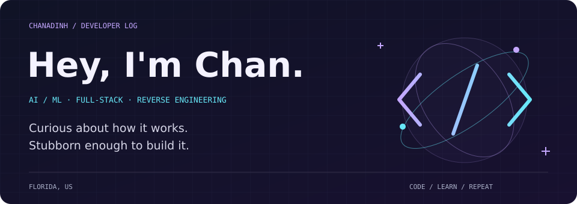
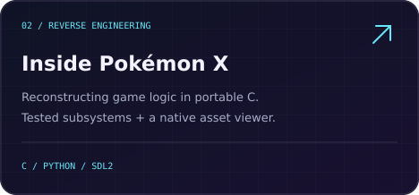
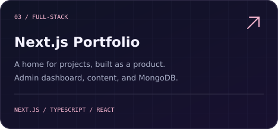
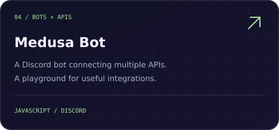

  

  
  
  

 

### A little about me

I'm a developer in Florida who likes following an idea all the way down—from the interface to the API, the model, or the game logic underneath.

Right now, that means **machine learning experiments**, **web applications**, and **figuring out what makes Pokémon X tick**. Outside the editor: anime, manga, science, and games.

 

### On my workbench

  
  
  

Experiments and works in progress. Pokémon X is an early reconstruction, with no playable PC port yet.

 

### GitHub stats & rating

  

GitHub activity · Letter-grade rank provided by <a href="https://github.com/stats-organization/github-stats-extended">GitHub Stats Extended</a>

 

### My toolkit

  &nbsp;
  &nbsp;
  &nbsp;
  &nbsp;
  &nbsp;
  &nbsp;
  &nbsp;
  &nbsp;
  &nbsp;
  

Python for pipelines and experiments. TypeScript for the web. C for understanding what happens underneath.

  

<b>A few more things about me</b>

- My interests tend to become projects. Games led me to reverse engineering; web development led me to bots and APIs.
- I like useful interfaces, readable code, and documentation that tells you what actually works.
- Always happy to talk about anime, interesting tools, or the thing you're building.

 

  

